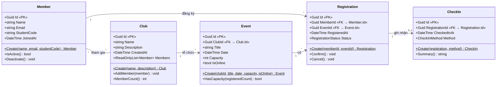

# Sơ đồ lớp sơ bộ – EduHub

## Giải thích quan hệ

| Quan hệ | Bội số | Ghi chú |
|---|---|---|
| Member – Club | * – * | Một sinh viên tham gia nhiều CLB, một CLB có nhiều thành viên (`Club.Members`). |
| Club – Event | 1 – * | Event giữ khoá ngoại `ClubId`. |
| Member – Registration | 1 – * | Registration giữ khoá ngoại `MemberId`. |
| Event – Registration | 1 – * | Registration giữ khoá ngoại `EventId`. |
| Registration – CheckIn | 1 – 0..1 | CheckIn giữ khoá ngoại `RegistrationId`; chưa check-in thì chưa có bản ghi. |

`Registration` là bảng nối giữa `Member` và `Event` (quan hệ nhiều–nhiều). `RegistrationStatus` (Pending/Confirmed/Cancelled) và `CheckInMethod` (Manual/QrCode/SelfService) là enum.
